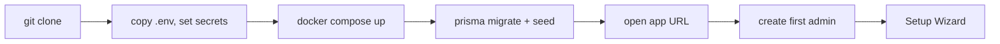
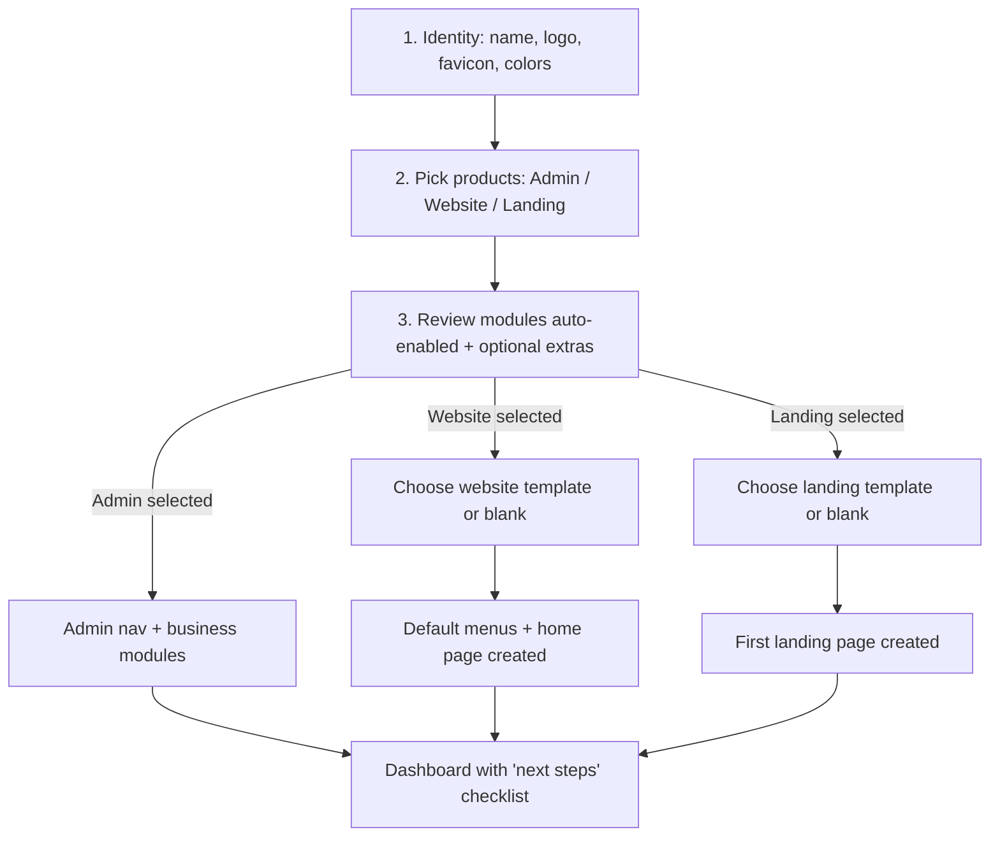
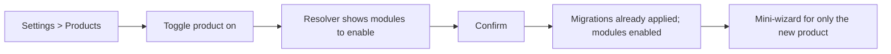
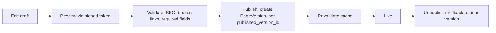

# 03 — Complete User Flows

Status: PROPOSAL. Conditional onboarding: the wizard only shows steps for selected products.

## 1. Developer setup (all scenarios)

Target: under 10 minutes, no manual steps beyond `.env`. Seed creates core modules only.

## 2. Setup Wizard (conditional)

Step 1 is always shown (identity is global). Everything after is gated by product choice. Wizard can be skipped and re-opened from Settings > Products.

## 3. Scenario A — Admin only
Identity -> Products: Admin -> modules: auth, users, roles, settings, identity (+ chosen business modules) -> dashboard. **Not shown:** CMS, menus, themes for public site, section builder, SEO. Admin title/logo/favicon come from identity.

## 4. Scenario B — Website only
Identity -> Products: Website -> auto-enable cms-core, pages, section-builder, media, menus, seo -> pick template -> edit pages in Section Builder -> Menus -> Preview -> SEO check -> Publish. Admin shell stays minimal (only what the product needs); admin product can be added later.

## 5. Scenario C — Landing only
Identity -> Products: Landing -> auto-enable landing, cms-core, section-builder, media, forms, seo -> pick landing template -> edit sections -> configure CTA + lead form -> Preview -> Publish. No menus, no multi-page website required.

## 6. Scenario D — Website + Landing pages
Website flow once, then "New Landing Page" from Content > Landing Pages. Landing sites reuse the section registry, media, and global identity, with optional per-site overrides and independent SEO and slug.

## 7. Scenario E — Full platform
All products on. One admin: Dashboard, Business modules, Content (Website pages, Landing pages, Menus, Media), Design (Themes, Templates), Settings (Identity, Products, Modules, SEO), Users and Roles.

## 8. Add a product later

No rebuild, no re-clone. Tables for all installed modules already exist; enabling flips status and shows nav.

## 9. Publish flow

## 10. Disable a product or module
Hide nav, gate routes (403/404 on public). Data retained. Re-enable restores. Hard delete only through an explicit "Remove data" action with a confirmation and a backup note.
